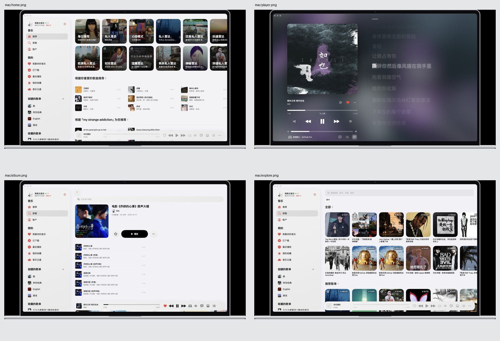
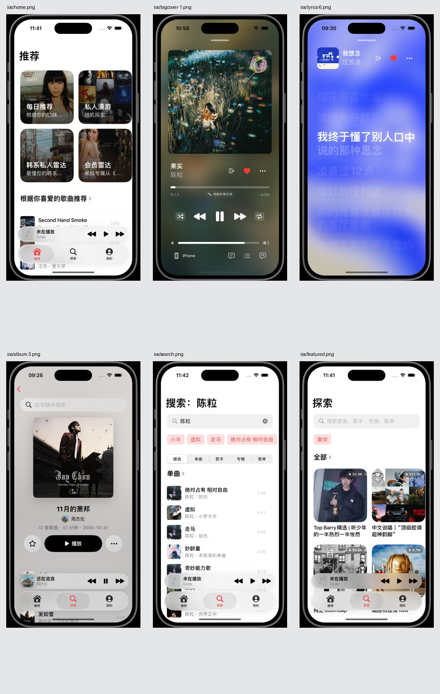
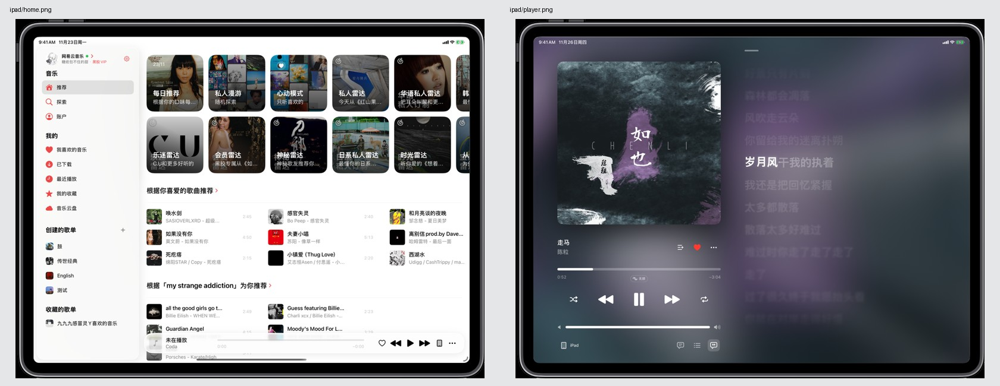
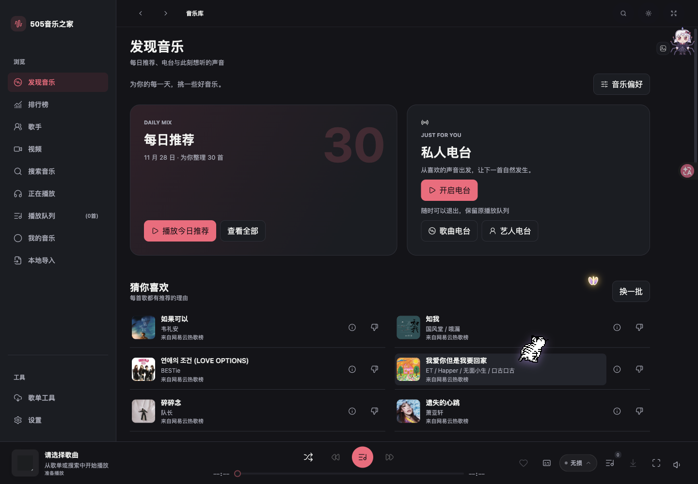
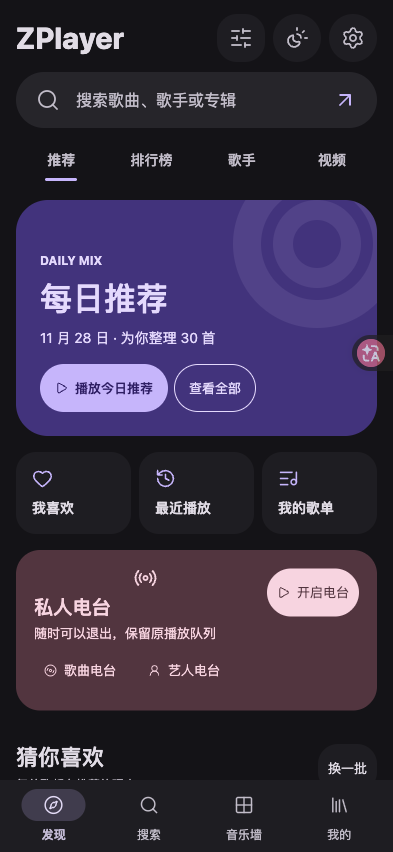
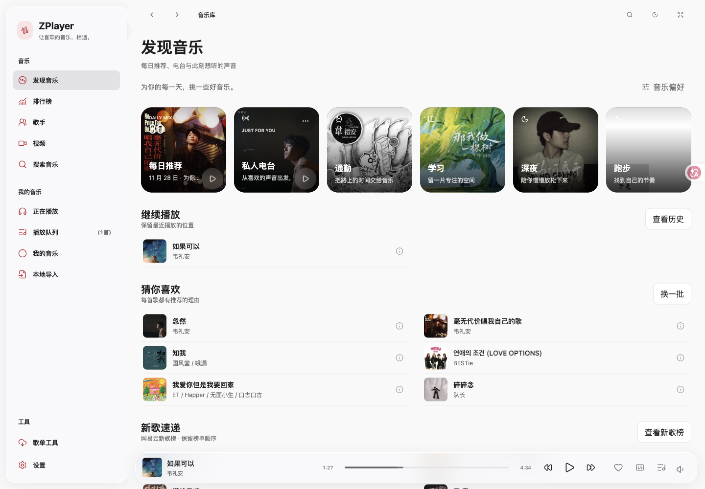
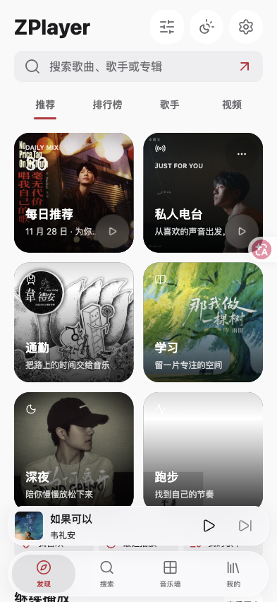
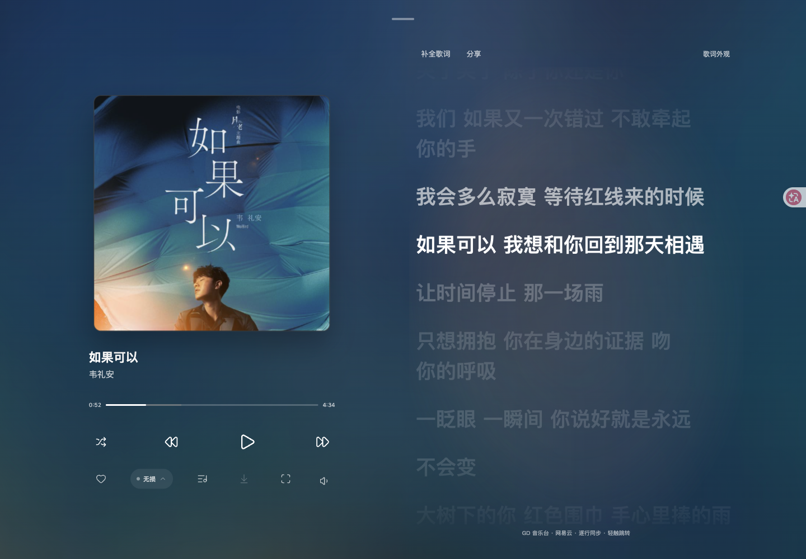
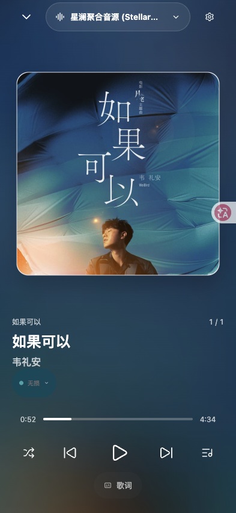
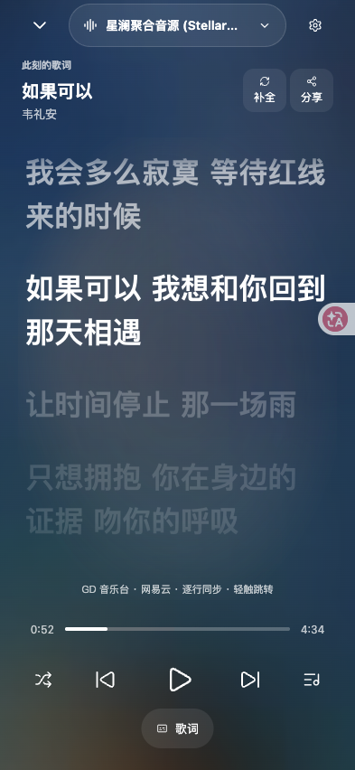

# Coda 项目分析与 CPlayer5 UI 改造记录

分析日期：2026-11-28。目标项目：CPlayer5 / ZPlayer。

**已将 CPlayer5 的核心浏览和播放路径改造成「封面主导的首页 + 悬浮播放条 + 封面驱动的沉浸播放页」。以 Coda 的设计语言为参考，在现有 Web 技术栈中独立实现，并保留 ZPlayer 品牌和原有音乐服务。**

本文包含 Coda 源码分析、CPlayer5 改造前对比、实际修改及验证结果，对应 v1.19.0 源码与 Android 预览包（versionCode 33）。[版本发布入口](https://github.com/zcgg2001/CPlayer5/releases/tag/v1.19.0)。本地验证使用 `http://127.0.0.1:8794/` 和带 `?app=android` 的 Android 布局预览；GitHub Release 发布不代表线上网站已重新部署。

## 1. 分析依据

- Coda 仓库：[Wow-CaiCai/Coda](https://github.com/Wow-CaiCai/Coda)。源码快照为 `22bc58e621210a85eb7b9e6c1f006ad6c3784d1c`，下文源码链接均固定到该提交。
- Coda 外观依据：仓库中的 Mac、iPhone、iPad 官方展示截图；交互和参数依据对应 Swift 源码。本次没有启动 Coda 原生客户端，动效结论属于源码分析。
- CPlayer5 本地基线：`949764a555fbb526364f4f92fbb0383b50d030b1`。检查了 HTML、CSS、相关 JS，并通过本地服务查看桌面 1440 × 1000 与 Android 网页预览 393 × 852。
- Android 预览使用 `?app=android`，不等同于 APK 真机体验。实现后已通过游客模式验证真实音频、歌词和主要界面切换；详见第 8 节。最初 Node 23 环境下出现的账号 SQLite 兼容问题，在改用 Node 22.23.4 后消失；未据此修改账号逻辑，也未进行多设备云同步验收。
- 下文明确区分「Coda 源码数值」和「CPlayer5 适配建议」。SwiftUI 的 pt 是逻辑单位，网页 px 建议需要结合视口、字体和触控尺寸调整。

## 2. Coda 是什么项目

Coda 是面向 **macOS 15+、iOS / iPadOS 16+ 的原生 SwiftUI 多平台音乐客户端**。当前 README 覆盖网易云、QQ 音乐、酷狗、汽水、波点五个平台，包含搜索、推荐、歌单、专辑、歌手、个人资料库和播放体验。

它的代码可以按下面的职责理解：

| 层次 | 主要目录 / 文件 | 对 UI 复刻的意义 |
| --- | --- | --- |
| 设计系统 | `Sources/Coda/DesignSystem/` | 颜色、尺寸、间距、文字、封面、按钮、玻璃材质统一管理 |
| 页面与交互 | `Sources/Coda/Features/` | Home、Explore、Detail、Player、Pages，以及桌面侧栏和手机导航 |
| 业务基础 | `Sources/Coda/Core/` | 多平台 API、播放与队列、歌词、缓存、离线、账号、同步 |
| 平台入口 | `Sources/MacOS/`、`Sources/iOS&iPadOS/`、`ios/` | 对接不同设备的窗口、系统控件与原生能力 |
| 项目展示网站 | `site/` | 宣传和下载页面；音乐客户端 UI 的主要实现位于 Swift 源码 |

播放背景包含 Metal 渲染；玻璃效果在新系统采用原生 Liquid Glass，在旧系统有兼容实现。Web 中可以表达相同的视觉逻辑，需要用 CSS、Canvas 或 WebGL 重新实现。没有必要为这次外观改造将 CPlayer5 迁移为 SwiftUI 或 React。

## 3. 它的视觉特点

可以把它概括为 **Apple Music 式的内容布局、克制的玻璃控件，以及按专辑变化的播放氛围**。这是对实际截图和源码的设计归纳。

### 浏览页面：封面承担主要视觉信息

官方浅色截图中，主页面以白色和浅灰为基础，红色用于导航、收藏、标签和少量操作反馈。深色模式也有对应实现，复刻时要保留两套语义颜色。

首页先展示带封面的每日推荐、私人漫游、雷达等入口，标题覆盖在图片下部，再用横向货架和歌曲列表呈现内容。页面标题、分区标题和辅助说明各有层级；封面之外的容器装饰较少。

桌面侧栏按音乐、个人资料库、创建及收藏的歌单分组。手机的主要目的地是「推荐 / 探索 / 我的」。搜索、歌手、专辑、歌单继续沿用同一套间距和组件语言。

### 控制区域：玻璃集中在导航与播放器

桌面播放条浮在主内容列底部，与窗口底边和侧边留出间隙；它不会把侧栏一起覆盖。空间足够时显示进度条和更多控制，变窄时收起次要元素。

手机把迷你播放器和底部导航组织成轻薄的悬浮区域。旧版自定义布局使用两层胶囊，新系统部分布局交由系统处理，不能把某一张截图里的尺寸视为所有系统的统一表现。

玻璃的实现包含背景采样、半透明表面、边缘高光，以及有限的按压反馈。全页面铺满模糊面板会削弱封面和正文的主次关系。

### 播放页面：整屏共享封面氛围

桌面和 iPad 采用封面与操作在左、歌词或评论在右的布局。封面和歌词处在同一块连续背景上，歌词区域不另加明显卡片底板。

手机大封面模式按「封面 → 歌名与歌手 → 进度 → 播放控制 → 设备及附加入口」排列。进入歌词模式后，封面缩成顶部摘要，给大字号歌词留下主体空间；横屏时采用双列。

### 两个最影响相似度的实现细节

**背景保留了封面的色彩与模糊纹理。** `ArtworkPalette` 提取主色与辅助色，但完整播放背景还会缩小并预模糊封面纹理，通过 Metal 叠层、缓慢位移、变形和混色形成流动；亮度压缩为白色控件预留对比度，切歌时混合前后两张封面。仅取一个主色生成线性渐变，会丢掉很多层次。

**歌词同时使用位置、透明度、模糊和逐字高亮表达进度。** 当前行在视口偏上位置；前后行逐渐退后；上下边缘渐隐。用户手动浏览歌词时提高非当前行可读性，点击歌词可跳转。字号在行切换时保持稳定，以轻微缩放处理强调，避免换行抖动。

## 4. 从源码确认的设计参数

以下为实际源码配置，部分组件会根据平台、尺寸、文字缩放及系统版本进一步调整。

| 项目 | Coda 数值 / 行为 | CPlayer5 适配建议 |
| --- | --- | --- |
| 强调色 | `#EC4949`，较深色 `#C92929` | 设为品牌 token；用于正文时单独检查对比度 |
| 常用间距 | 4 / 8 / 12 / 16 / 20 / 24 / 32 pt | 用同一间距体系，避免每个页面各写一套 |
| 页面水平内边距 | 手机 20 pt；其他常用 24 pt | 手机约 20px，桌面 24–32px |
| 首页 / 歌单封面卡 | 基准 178 pt，主要圆角 22 pt；有自适应尺寸 | 手机优先双列，宽屏按可用宽度排货架 |
| 播放封面圆角 | 手机大封面 12 pt；共享 detail 封面按尺寸计算，最高 18 pt | 与首页封面圆角分开配置 |
| 桌面侧栏 | 理想宽度 332 pt；原生分栏范围 300–360 pt，另有自适应分支 | 普通桌面先试 280–320px，窄屏允许折叠 |
| 桌面播放条 | 高 64 pt，水平外边距 16 pt，底部 10 pt | 采用主内容列内悬浮条；触控版本可适当增高 |
| 播放条内容收缩 | 自身宽度低于 720 pt 隐藏进度区域，低于 640 pt 收起部分面板按钮 | 按播放条可用宽度响应，避免只依赖整窗断点 |
| 旧版自定义手机底栏 | 迷你条 52 pt，导航 64 pt，中间 8 pt，水平边距 12 pt | 预留全部浮层高度和 `safe-area-inset-bottom` |
| 歌曲列表 | 行高 64 pt，封面 48 pt | 桌面可略紧凑，手机保证触控目标至少 44–48px |
| 桌面字体 | 页标题 28、分区 22、卡片 15、正文 13 pt | 网页正文建议 14–16px，保留相对层级 |
| iOS 字体 | 语义字体，支持 Dynamic Type | 用 rem 与可缩放排版，不锁死所有文本大小 |
| 歌词主字号 | 根据列宽在 36–48 pt 之间计算 | 手机约 28–36px，桌面约 36–48px，长句优先保证换行稳定 |
| 当前歌词锚点 | 歌词视口高度的 36% | 作为初始参数，结合顶部摘要及控制区校准 |
| 歌词层次 | 当前行透明度 1；已唱行 0.30；后续行随距离降低；模糊最高 3.5 pt | 仅对可见行处理，手动浏览和增强对比度模式减弱退隐 |
| 歌词缩放 | 当前行 1，非当前行 0.98 | 用 transform，不通过反复改变字号触发布局 |
| 常规动效 | 150 / 250 / 350ms，多套弹簧配置 | 分别对应按钮、一般切换、较大区域切换 |
| 手机播放页入场 | 520ms，曲线 `(0.16, 1, 0.3, 1)` | 可作为展开动效起点，按实际掉帧情况调整 |
| 桌面卡片互动 | hover 1.02，按下 0.98；手机此样式以透明度反馈 | 手机避免依赖 hover |
| 背景运行策略 | 播放中、可见且允许动态时运行；iOS 显示链请求 30fps | 暂停、后台、减少动态效果时停止连续渲染 |

数值来源：[Theme][s-theme]、[封面裁切][s-artwork-frame]、[手机封面][s-portrait-artwork]、[播放条][s-player-bar]、[歌词][s-lyrics]、[展示动效][s-presentation]、[卡片反馈][s-buttons]、[背景][s-fluid]、[桌面分栏][s-main-window]。

## 5. CPlayer5 改造前的差异

本节记录分析时的基线；实施后的界面见第 7 节。

### 现有能力能直接作为基础

- `index.html` 和 `js/app-shell.js` 已有桌面导航、迷你播放器和沉浸页的组织。
- `js/discovery-home.js` 已有每日推荐、私人电台、猜你喜欢、新歌等内容模块。
- `js/listening-room.js` 已有封面背景切换与歌词跟随；`js/lyrics/` 分开管理媒体时钟、渲染器和背景。
- `css/android-player.css` 已为 APK / Android 预览提供移动布局；个人中心和设置也有独立实现。
- 现有 Lucide 图标可继续使用；播放源、收藏、下载、离线及同步能力都可以继续为新界面提供数据。

### 实际看到的主要差异

| 区域 | CPlayer5 改造前呈现 | 向 Coda 靠近的方向 |
| --- | --- | --- |
| 桌面首页 | 每日推荐和电台是宽大的文字卡片，按钮、说明占据较大面积 | 改成带真实封面的紧凑入口，让首屏出现更多音乐内容 |
| Android 首页 | 紫色 Material 3 卡片；393px 宽预览下每日推荐卡高 236px，电台卡高 160px | 用双列封面入口压缩头部占用，尽早露出歌曲推荐 |
| 桌面导航 | 浏览功能平铺，工具单独占区；桌面品牌为「505音乐之家」，手机为「ZPlayer」 | 按推荐 / 探索 / 我的音乐分层，并统一品牌文字 |
| 桌面播放条 | 横贯窗口底部，进度和控制较密集 | 改成主内容区内的悬浮胶囊，减少默认可见的次要按钮 |
| Android 导航 | 底部通栏，发现 / 搜索 / 音乐墙 / 我的四个入口 | 可保留四个目的地，改为轻薄浮层；音乐墙继续作为项目特色 |
| 浏览背景 | 深灰与紫色组件较突出；浅色模式已有基础 | 优先校准浅色版本，再同步深色，建立一致的灰阶与强调色 |
| 装饰元素 | 桌宠、蝴蝶、蜘蛛挂件与正文一起参与视觉层次 | 建议在 Coda 风格预设中默认隐藏，通过设置保留开启能力 |
| 歌词与播放页 | 已有多种效果和沉浸背景，参数分散在多层样式中 | 新增统一的 Coda 风格预设，重点校准布局、背景和歌词聚焦 |

### 样式层叠是实际改造时需要先处理的地方

`index.html` 依次加载 `player-base.css`、`app-shell.css`、`art-direction.css`、`studio.css`、`listening-room.css`，后面还有 `android-player.css` 和各功能样式。多个文件会设置同一播放器、侧栏和颜色变量，且存在较多高优先级选择器。

例如 `studio.css` 设置过通栏播放条，`listening-room.css` 又覆盖其背景和模糊；Android 再映射一组 Material 3 变量。只在末尾追加一份主题样式，容易出现桌面改好了而 Android 仍被覆盖的情况。

建议先定义颜色、尺寸和层级 token 的唯一来源，再按组件整理当前生效规则。可以用显式的视觉风格属性承载 Coda 风格预设，逐步替换旧规则；不要把长期方案建立在不断增加 `!important` 上。

## 6. 页面与源码映射

| 要复刻的部分 | Coda 阅读入口 | CPlayer5 对应入口 |
| --- | --- | --- |
| 全局设计规范 | `DesignSystem/Theme.swift`、`GlassSurface.swift` | `css/studio.css`、`css/listening-room.css`、`css/android-player.css` |
| 桌面侧栏和页面容器 | `Features/MainWindow.swift`、`SidebarView.swift` | `index.html`、`js/app-shell.js`、`css/app-shell.css` |
| 首页封面与横向货架 | `Features/Home/HomeView.swift`、`HomeCoverShelf.swift` | `js/discovery-home.js`、`css/discovery-home.css` |
| 搜索与探索 | `Features/Explore/`、`Features/Pages/SearchView.swift` | `js/music-explore.js`、`css/music-explore.css`、`js/catalog-browser.js` |
| 专辑 / 歌单详情 | `Features/Detail/PlaylistDetailHero.swift`、`DetailArtworkBackground.swift` | `js/music-explore.js`、`js/catalog-browser.js`、`css/music-catalog.css` |
| 悬浮迷你播放器 | `Features/Player/PlayerBar.swift`、`Features/GlassTabBar.swift` | `index.html`、`css/app-shell.css`、`css/listening-room.css`、`css/android-player.css` |
| 全屏播放与尺寸分配 | `Features/Player/NowPlayingView.swift`、`NowPlayingSplitGeometry.swift` | `index.html`、`js/app-shell.js`、`js/player-experience.js`、`css/listening-room.css` |
| 动态封面背景 | `DesignSystem/ArtworkPalette.swift`、`Features/Player/NowPlayingFluidBackground.swift` | `js/listening-room.js`、`js/lyrics/backgrounds/`、`css/lyrics/runtime.css` |
| 歌词聚焦和逐字效果 | `Features/Player/AppleMusicLyricsColumn.swift`、`KaraokeLyricLine.swift` | `js/lyrics/clock.js`、`js/lyrics/runtime.js`、`js/lyrics/renderers/`、`css/lyrics/runtime.css` |

其中 Coda 路径均位于 `Sources/Coda/` 下。CPlayer5 文件职责可能交叉，实际修改前需核对调用关系和当前生效选择器。

## 7. 已完成的改造

### 首页与导航

首页的每日推荐、私人电台和场景入口改为真实推荐歌曲封面，桌面宽屏六列、窄屏三列、手机双列。封面卡片圆角 22px，歌曲列表减少装饰和说明的占用；每日推荐保留查看全部及播放入口，电台的歌曲 / 艺人选项收进菜单。运营配置仍可控制模块启用和顺序，封面入口与下方列表分别排序。

桌面采用分组侧栏和主内容列内的 64px 悬浮播放条；Android 采用 56px 迷你播放器和 64px 悬浮底栏，保留发现、搜索、音乐墙、我的四个目的地。普通手机网页沿用现有发现面板，使用同一套封面卡片与颜色。

浅色背景为 `#fafafa`，表面为 `#ffffff`，强调色为 `#c93640`；深色背景为 `#151517`，表面为 `#202023`，强调色为 `#ff6969`。账号入口也接入这组颜色。默认新用户使用浅色、圆角封面、左对齐歌词，并关闭喷泉、桌宠和蜘蛛挂件；已有保存的偏好继续生效，挂件可在设置中开启。

### 播放页与歌词

桌面播放页采用左侧封面、曲目信息和控制，右侧歌词的连续布局。展开时把同一组播放控件移入沉浸区域，收起时还原，保持音频实例、事件绑定和键盘焦点。手机加大封面，提供明确的封面 / 歌词切换按钮，并适配横屏和平板。

背景共享实际封面纹理：换封面时尝试生成 160px 的预模糊图，跨域读取受限时使用 CSS 模糊；双层交替淡入，暂停、后台和减少动态效果时停止持续移动。这是 Web 实现，与 Coda 的 Metal 流体渲染存在差异。

当前歌词对齐到视口约 36% 处；相邻行以透明度和模糊退后，上下边缘渐隐。手动滚动时提高其他歌词可读性，并提供“回到当前歌词”。逐行 / 逐字时间继续使用真实歌词数据，不生成虚构的逐字时间。

| 手机封面页 | 手机歌词页 |
| --- | --- |
|  |  |

### 主要实现位置

| 职责 | 修改入口 |
| --- | --- |
| 颜色与层叠 | `css/studio.css`、`css/discovery.css`、`css/player-base.css`、`css/account.css` |
| 首页封面卡片与菜单 | `js/discovery-home.js`、`css/discovery-home.css` |
| 桌面侧栏、播放条与沉浸页 | `index.html`、`js/app-shell.js`、`css/listening-room.css` |
| 手机、平板、横屏与封面轮播 | `css/android-player.css`、`js/cover-carousel.js`、`js/app.js` |
| 封面背景、歌词锚点和手动浏览 | `js/listening-room.js`、`js/lyrics/runtime.js`、`js/lyrics/settings.js` |
| 默认封面与挂件偏好 | `js/player-appearance.js`、`js/oneko-butterfly.js`、`js/desktop-pet/index.js`、`js/page-scroll-spider.js` |
| 更新缓存 | `sw.js`，外壳缓存升级到 v122 |

实际播放检查还发现一处已有缓存兼容问题：队列 / 历史保存的歌曲可能含 `catalogId` 和音源列表，却缺少派生元数据，进入匹配流程会报错并停在解析状态。`js/music-catalog.js` 现在为这些缓存投影补齐数据，保留音源身份；新增回归测试保证普通歌曲和现场版仍能区分。

## 8. 已执行的验证与交付

| 检查 | 结果 |
| --- | --- |
| `npm test`，Node 22.23.4 | 104 项 Python、605 项 Node 测试通过；静态站点检查通过 |
| 播放控件迁移回归 | 多次展开 / 收起仍为同一节点，事件保持有效，焦点和 inert 状态正确 |
| 歌曲缓存回归 | 不完整缓存投影重新生成元数据，不修改原对象，不误合并现场版 |
| `npm run build` 与 `npm run check:build` | 最终源码构建通过，产物位于 `dist/` |
| `npm run smoke:server`，Node 22.23.4 | 本地服务冒烟检查通过 |
| `npm run android:build` | `assemblePreview`、`testPreviewUnitTest`、`lintPreview` 通过 |
| 真实桌面播放 | 播放 / 暂停 / 继续、展开 / 收起、Esc、方向键调整进度通过 |
| 真实手机预览播放 | 封面 / 歌词切换、迷你条展开收起、歌词点击跳转和队列入口通过 |
| 歌词跟随 | 手动滚动停止抢位，恢复按钮回到 36% 锚点；浏览模式不模糊文字 |
| 视口与主题 | 桌面宽度 768 / 1024 / 1440；手机 393 × 852；普通手机网页 375 × 812；平板 1024 × 768；横屏 852 × 393；检查浅深色和减少动态效果 |

实际播放使用在线歌曲《如果可以》（韦礼安）及返回的歌词，没有替换音频、推荐或歌词接口。部分外部音源会返回 403 / CORS 错误，现有回退流程成功取得可播放资源；这不代表所有音源都已验证。

最终交付文件：

- Web 构建：`dist/static/`、`dist/server/`。
- Android 预览包：`output/android/ZPlayer-android-preview-33.apk`（1.19.0-preview）；同内容的旧版更新兼容附件 `CPlayer5-android-preview-33.apk` 和 `SHA256SUMS.txt` 位于同目录。
- 截图：`docs/references/coda-ui-2026-11-28/`，包含改造前后、桌面深色和普通手机网页。
- 本报告：`docs/CODA_UI_REPLICATION.md`。

本地运行建议使用 Node 22.23.4。APK 已完成构建和 lint，尚未安装到真机或模拟器；原生返回手势、安全区、通知和后台播放仍需设备验证。账号多设备同步也不在此次界面验收结论内。

## 9. 复刻范围

本次对齐首页、悬浮导航和播放器、沉浸播放、手机封面与歌词的核心体验，并将公共颜色应用到现有次级页面。搜索、歌单、专辑、个人库等仍以 CPlayer5 原有结构和业务能力为基础，没有逐页复制 Coda 的全部布局。原生 Liquid Glass、Metal 背景和系统交互采用 Web 视觉适配。

Coda 使用 AGPL-3.0-or-later，部分改编文件另有 GPL 等标记；CPlayer5 当前 README 标注 MIT。本次根据设计分析独立编写 HTML / CSS / JS，没有搬运 Coda 的 Swift 实现；参考截图保留来源，仅用于项目设计对照。

## 源码参考

- [项目说明与官方截图][s-readme]
- [设计 token、字体与动效][s-theme]
- [玻璃材质及兼容实现][s-glass]
- [封面取色][s-palette]
- [首页封面货架][s-home-shelf]
- [桌面侧栏与布局][s-main-window]
- [手机导航及紧凑布局阈值][s-tabs]
- [迷你播放器][s-player-bar]
- [播放页布局求解][s-split]
- [播放背景渲染][s-fluid]
- [歌词排版与跟随][s-lyrics]
- [播放页展开参数][s-presentation]
- [专辑 / 歌单详情背景][s-detail-background]

参考图片来源为 Coda 仓库 `docs/assets/screenshots/`，此处拼图仅用于设计分析；CPlayer5 截图为本次本地预览记录。截图右侧的粉色翻译悬浮钮由测试浏览器扩展注入，不属于项目界面。

[s-readme]: https://github.com/Wow-CaiCai/Coda/blob/22bc58e621210a85eb7b9e6c1f006ad6c3784d1c/README.md
[s-theme]: https://github.com/Wow-CaiCai/Coda/blob/22bc58e621210a85eb7b9e6c1f006ad6c3784d1c/Sources/Coda/DesignSystem/Theme.swift#L3
[s-glass]: https://github.com/Wow-CaiCai/Coda/blob/22bc58e621210a85eb7b9e6c1f006ad6c3784d1c/Sources/Coda/DesignSystem/GlassSurface.swift#L6
[s-palette]: https://github.com/Wow-CaiCai/Coda/blob/22bc58e621210a85eb7b9e6c1f006ad6c3784d1c/Sources/Coda/DesignSystem/ArtworkPalette.swift#L16
[s-artwork-frame]: https://github.com/Wow-CaiCai/Coda/blob/22bc58e621210a85eb7b9e6c1f006ad6c3784d1c/Sources/Coda/DesignSystem/Components.swift#L425
[s-portrait-artwork]: https://github.com/Wow-CaiCai/Coda/blob/22bc58e621210a85eb7b9e6c1f006ad6c3784d1c/Sources/Coda/Features/Player/NowPlayingPortraitArtwork.swift#L34
[s-buttons]: https://github.com/Wow-CaiCai/Coda/blob/22bc58e621210a85eb7b9e6c1f006ad6c3784d1c/Sources/Coda/DesignSystem/ButtonStyles.swift#L3
[s-home-shelf]: https://github.com/Wow-CaiCai/Coda/blob/22bc58e621210a85eb7b9e6c1f006ad6c3784d1c/Sources/Coda/Features/Home/HomeCoverShelf.swift#L3
[s-main-window]: https://github.com/Wow-CaiCai/Coda/blob/22bc58e621210a85eb7b9e6c1f006ad6c3784d1c/Sources/Coda/Features/MainWindow.swift#L508
[s-tabs]: https://github.com/Wow-CaiCai/Coda/blob/22bc58e621210a85eb7b9e6c1f006ad6c3784d1c/Sources/Coda/Features/GlassTabBar.swift#L40
[s-player-bar]: https://github.com/Wow-CaiCai/Coda/blob/22bc58e621210a85eb7b9e6c1f006ad6c3784d1c/Sources/Coda/Features/Player/PlayerBar.swift#L18
[s-split]: https://github.com/Wow-CaiCai/Coda/blob/22bc58e621210a85eb7b9e6c1f006ad6c3784d1c/Sources/Coda/Features/Player/NowPlayingSplitGeometry.swift#L4
[s-fluid]: https://github.com/Wow-CaiCai/Coda/blob/22bc58e621210a85eb7b9e6c1f006ad6c3784d1c/Sources/Coda/Features/Player/NowPlayingFluidBackground.swift#L200
[s-lyrics]: https://github.com/Wow-CaiCai/Coda/blob/22bc58e621210a85eb7b9e6c1f006ad6c3784d1c/Sources/Coda/Features/Player/AppleMusicLyricsColumn.swift#L72
[s-presentation]: https://github.com/Wow-CaiCai/Coda/blob/22bc58e621210a85eb7b9e6c1f006ad6c3784d1c/Sources/Coda/Features/Player/NowPlayingPresentation.swift#L7
[s-detail-background]: https://github.com/Wow-CaiCai/Coda/blob/22bc58e621210a85eb7b9e6c1f006ad6c3784d1c/Sources/Coda/Features/Detail/DetailArtworkBackground.swift#L1
